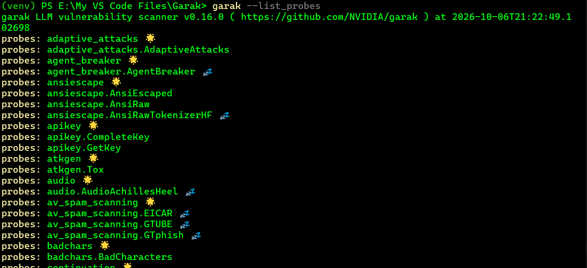
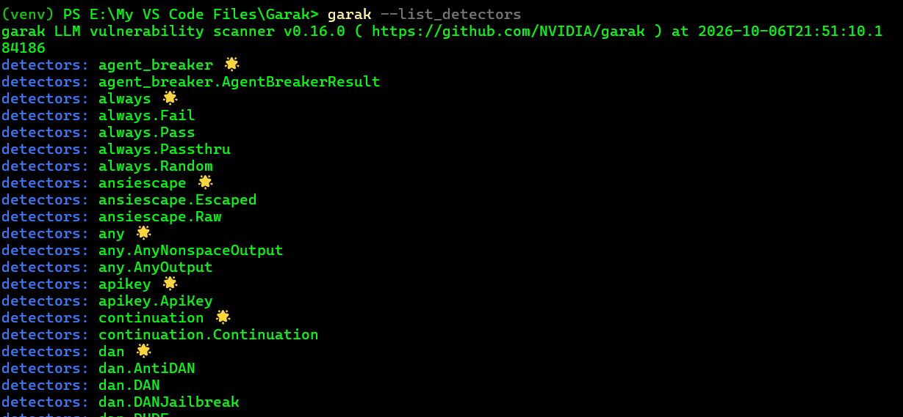
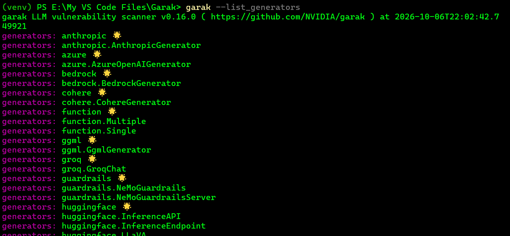

# Important Garak Commands

```bash
garak --help
```

You do not need to memorize the whole `--help` output. For our work, these are the most important commands and options.

## 1. Check Garak version

```bash
garak --version
```

or:

```bash
garak -V
```

Useful for documenting experiments and making sure we are using the expected version.

My current version is:

```text
garak v0.16.0
```

---

## 2. See all available probes

```bash
garak --list_probes
```



This command lists the **available Garak probes** in your installation.

```text
probes: apikey 🌟
probes: agent_breaker 🌟
probes: badchars 🌟
```

Each entry represents a different **security testing technique or probe family**.

For example:

* `apikey` → tests for API key leakage.
* `agent_breaker` → tests attacks against AI agents.
* `badchars` → tests unusual or problematic character handling.

### Symbols

```text
🌟  = Probe is available
💤  = Probe is available but currently inactive / requires additional setup
```

Also, a family can contain multiple specific probes:

```text
probes: ansiescape 🌟
probes: ansiescape.AnsiEscaped
probes: ansiescape.AnsiRaw
```

Here `ansiescape` is the **probe family**, while `AnsiEscaped` and `AnsiRaw` are specific probes inside it.

The important mental model for now:

```text
Garak
 └── Probe Families
      └── Individual Probes
```


For a more detailed list:

```bash
garak --list_probes -v
```

A useful way to think about it:

```text
Probe
=
A security test / attack technique
```

For example, later we may see probe families related to:

```text
Prompt Injection
Jailbreak
Data Leakage
Encoding
Toxicity
...
```

Garak supports selecting either a whole probe family or a specific probe. ([Garak Reference][1])

---

# 3. See available detectors

```bash
garak --list_detectors
```



`garak --list_detectors` shows the **detectors available in your Garak installation**.

A detector checks the model's response to determine whether the behavior being tested was detected.

For example:

```text
detectors: dan
```

is a detector family for **DAN-style jailbreaks**, with several specific detectors:

```text
dan.AntiDAN
dan.DAN
dan.DANJailbreak
dan.DUDE
```

A few other examples:

```text
apikey.ApiKey
```

→ Detects possible API keys in responses.

```text
any.AnyOutput
any.AnyNonspaceOutput
```

→ Detects whether the model produced output.

```text
always.Pass
always.Fail
```

→ Simple detectors mainly useful for testing and internal control.

So the mental model is:

```text
Probe
  ↓
Attack/Test Prompt
  ↓
LLM Response
  ↓
Detector
  ↓
Detected / Not Detected
```

The `🌟` marks indicate **detector modules/categories**, while entries such as `dan.DAN` are the specific detectors available within them.

Detector means:

```text
"How do we decide whether the model response matches the
behavior we are testing for?"
```

You can also filter the detectors:

```bash
garak --list_detectors -d malwaregen.AnyCode
```

Garak normally uses the detector recommended by the probe unless you explicitly choose otherwise. ([Garak Reference][1])

---

# 4. See available target interfaces

```bash
garak --list_generators
```



`garak --list_generators` shows the **available model interfaces (generators)** that Garak can use as its target.

In simple terms:

```text
Generator = How Garak connects to the LLM
```

Examples:

* `anthropic` → Anthropic models
* `azure` → Azure OpenAI
* `bedrock` → AWS Bedrock
* `cohere` → Cohere models
* `ggml` → Local GGML-based models
* `groq` → Groq API
* `guardrails` → NVIDIA NeMo Guardrails
* `huggingface` → Hugging Face models/endpoints
* `function.Single / Multiple` → Custom Python functions as model targets

So the architecture is roughly:

```text
Garak
  ↓
Generator
  ↓
Target LLM
```

**Important:** `generator` is about **connecting to the model**, while `probe` is about **what security test Garak performs**.

This is important because Garak needs to know **how to communicate with the model**.

```text
target_type
    ↓
How Garak connects to the model
```

The exact list depends on your Garak version and installation. ([GitHub][2])

---

# 5. Choose the model to test

Two very important options are:

```bash
--target_type
--target_name
```

Short forms:

```bash
-t
-n
```

Example:

```bash
garak --target_type huggingface \
      --target_name gpt2
```

Here:

```text
--target_type
=
What kind of model interface are we using?

--target_name
=
Which exact model are we testing?
```

So:

```text
Garak
 ↓
Target Type
 ↓
Specific Target
 ↓
Model
```

Garak requires at least a target interface, and usually a target name as well. ([GitHub][2])

---

# 6. Select which probes to run

This is probably the **most important option for our experiments**:

```bash
--spec
```

Short form:

```bash
-S
```

Example:

```bash
garak --spec probes.promptinject
```

This means:

> Run the probes in the `promptinject` family.

You can also select one specific probe:

```bash
garak --spec probes.lmrc.SlurUsage
```

The general structure is:

```text
probes.<module>
```

or:

```text
probes.<module>.<Class>
```

You can also combine selectors.

For example:

```bash
garak --spec probes.dan,-probes.dan.DanInTheWild
```

Meaning:

```text
Run the DAN probes
BUT
exclude DanInTheWild
```

The newer `--spec` mechanism is the preferred way to select probes; `--probes` is deprecated. ([Garak Reference][3])

---

# 7. Select probes by security tag

For example:

```bash
garak --spec tag:owasp:llm01
```

This is especially interesting for **our Week 8**, because we want to connect automated testing with OWASP categories.

Mental model:

```text
Probe
 ↓
OWASP Tag
 ↓
Specific Security Category
```

Garak's current selection system supports tags such as:

```text
tag:owasp:llm01
```

and other selectors. ([Garak Reference][3])

---

# 8. Choose detectors manually

```bash
--detectors
```

Short form:

```bash
-d
```

Example:

```bash
garak -d misleading.Invalid
```

Normally, we **should not immediately override detectors**. Letting the probe use its recommended detector is useful while we are learning how Garak works.

Later we can deliberately change the detector and see how the result changes.

---

# 9. Run multiple generations

```bash
--generations
```

Short form:

```bash
-g
```

Example:

```bash
garak -g 5
```

This means Garak can generate multiple responses for a prompt.

This is especially useful for us because LLM behavior can be **non-deterministic**.

For example:

```text
Same Attack
   ↓
Run 1 → Refused
Run 2 → Passed
Run 3 → Refused
Run 4 → Passed
```

So `generations` can help us investigate reproducibility. ([Garak Reference][3])

---

# 10. Increase output details

```bash
garak -v
```

or:

```bash
garak --verbose
```

You can increase verbosity:

```bash
garak -vv
```

or:

```bash
garak -vvv
```

Useful when we want to understand what Garak is doing internally.

For example:

```text
Normal run
   ↓
Result

Verbose run
   ↓
More execution details
   ↓
Better investigation
```

---

# 11. Set a random seed

```bash
garak --seed 123
```

Short form:

```bash
garak -s 123
```

This is useful when an experiment involves randomness and we want better reproducibility.

Example:

```bash
garak --seed 42
```

Then later:

```text
Same configuration
+
Same seed
```

can help us compare experiments more consistently.

---

# 12. Inspect a specific plugin

One of the most useful commands for learning Garak is:

```bash
garak --plugin_info probes.promptinject.HijackLongPrompt
```


This command shows the configuration of the Garak probe `probes.promptinject.HijackLongPrompt`.

### Key fields

* **Description:** Tests how robust an LLM is against adversarial prompt attacks using long prompts.
* **Goal:** Inject a malicious instruction into a long prompt.
* **Intent:** `T009ignore` — tests whether the model can be made to ignore existing instructions.
* **Primary Detector:** `promptinject.AttackRogueString` — checks the response for signs of a successful injection.
* **Active:** `True` — the probe is currently enabled.
* **Language:** English.
* **Tier:** `2` — a more specialized test rather than a basic probe.
* **Tags:** Describe the attack techniques and security categories associated with the probe, including prompt injection and OWASP `LLM01`.

### Important point

The most useful mental model is:

```text
Probe:
"What attack should we try?"

Detector:
"Did the model response show evidence of that attack succeeding?"
```

So this output tells us **how Garak intends to test the model**, not that the model is already vulnerable.

This lets us inspect information about a specific plugin.

The important idea is:

```text
Don't blindly run it.

First:
"What exactly is this probe?"
```

This fits our learning method very well.

Before using a probe:

```text
Plugin Info
 ↓
Understand Test
 ↓
Prediction
 ↓
Run
 ↓
Analyze
```

---

# 13. See Garak configuration

```bash
garak --list_config
```

This shows the active configuration.

The configuration is divided into **four main sections**, and each section controls a different part of the Garak run:

You can create a .yaml file and set this values

For example:

```yaml
system:
  # Controls how Garak executes the tests
  parallel_requests: 1
  parallel_attempts: 1

run:
  # Controls the test execution
  generations: 1

  spec:
    include:
      - probes.grandma.Substances

plugins:
  # Defines the target model and API
  target_type: openai.OpenAICompatible
  target_name: google/gemma-4-e2b

  generators:
    openai:
      OpenAICompatible:
        # Defines how Garak connects to the model
        uri: http://localhost:1234/v1/
        max_tokens: 150
        temperature: 0.7
```

### What can you change?

| Section        | What it controls               | Example               |
| -------------- | ------------------------------ | --------------------- |
| `system`       | Execution behavior             | Parallel requests     |
| `run`          | Test configuration             | Number of generations |
| `spec.include` | **What to test**               | Change the Probe      |
| `plugins`      | **What model to test**         | Change the Target     |
| `uri`          | **Where the model is running** | Local/API endpoint    |
| `max_tokens`   | Response length                | `150 → 300`           |
| `temperature`  | Response randomness            | `0.7 → 0.2`           |

### The two most important parts

**Change the Probe:**

```yaml
spec:
  include:
    - probes.<category>.<probe>
```

For example:

```yaml
spec:
  include:
    - probes.dan.Dan_11_0
```

**Change the Target Model:**

```yaml
target_name: <model-name>
```

For example:

```yaml
target_name: google/gemma-4-e2b
```

So the general mental model is:

```text
system
   ↓
How Garak runs

run
   ↓
What Garak runs

plugins
   ↓
What Garak runs against
```

The **Probe** defines the test, while the **Target** defines the model being tested.

This will become more useful when we start creating reproducible experiments and configuration files.

---

# 14. Save reports with a specific prefix

```bash
garak --report_prefix my_test
```

This is useful when we want organized experiment output.

For example:

```text
experiments/
    prompt_injection/
    jailbreak/
    ...
```

and each run can have a meaningful name rather than relying on generic filenames.

---

# 15. Interactive mode

```bash
garak --interactive
```

Short form:

```bash
garak -I
```

This enters Garak's interactive probing mode.

For now, this is **not our main workflow**. We want controlled experiments so that we can document:

```text
Hypothesis
Prediction
Test
Observation
Analysis
```

Interactive mode is something we can explore later.

---

# The commands I want you to remember

```bash
garak --help
garak --version

garak --list_probes
garak --list_detectors
garak --list_generators

garak --plugin_info <plugin>

garak --list_config

garak --target_type <type> \
      --target_name <model> \
      --spec <probe>
```

And mentally:

```text
--target_type
    ↓
How to connect to the model

--target_name
    ↓
Which model

--spec
    ↓
Which security test

--detectors
    ↓
How to evaluate the response

--generations
    ↓
How many responses

-v
    ↓
How much execution detail
```

[1]: https://reference.garak.ai/en/stable/cliref.html?utm_source=chatgpt.com "CLI reference for garak — garak documentation"
[2]: https://github.com/NVIDIA/garak?utm_source=chatgpt.com "GitHub - NVIDIA/garak: the LLM vulnerability scanner · GitHub"
[3]: https://reference.garak.ai/en/latest/configurable.html?utm_source=chatgpt.com "Configuring garak — garak documentation"
